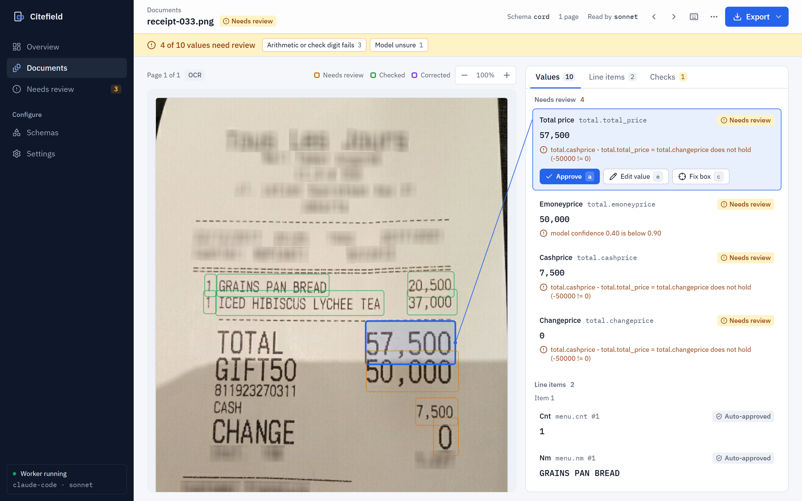

# Citefield

**Self-hosted document field extraction where every value points to the words it was read from.**

Drop in invoices and receipts (PDF or photos). Citefield reads them with a vision model, ties each extracted value to
the exact words on the page, checks the arithmetic, and sends anything uncertain to a review queue with the reason
written out. What passes every check is approved automatically; what does not waits for a person.



## Why

Extraction tools return values. Checking them means finding each one on the page again, and a wrong value that
looks plausible goes straight into the books. Citefield's answer is to make every value prove itself:

- **Every value has a box.** The model cites the ids of the OCR (or PDF text-layer) words it read; the box is built
  from those words' real coordinates, never drawn by the model. A citation that does not contain the value is flagged,
  not trusted.
- **Every decision has a reason.** A field goes to review if any check fails, and the reviewer sees which one: the
  second read disagrees, a total does not add up, the citation covers only part of the value, the same printed number
  was used for two roles, or the model itself was unsure.
- **Every number below is reproducible.** `citefield eval` re-runs the measurement on open datasets; the table in this
  README is generated from its output.

There is deliberately no "confidence score". In development a single score could not separate right from wrong values
reliably, so Citefield reports which checks fired instead.

## Accuracy

Measured with `citefield eval` on open, labelled datasets. Two reads per document (image + OCR words, then image
only); cost is the API price of both reads, estimated from Claude's image-token formula.

<!-- eval:start -->
| Data | Model | Values right | Box on the right words | Auto-approved | Errors among auto-approved | Wrong values sent to review | API cost / doc |
|---|---|---|---|---|---|---|---|
| CORD v2 receipts (photos), docs 25-49 | `claude-sonnet-5-5` | 88.7% | 96.3% | 77.3% | 0.8% | 10/12 | $0.0238 |
| FATURA invoices (synthetic), templates 31-50 | `claude-sonnet-5-5` | 100.0% | 100.0% | 96.4% | 4.7% | 3/8 | $0.0183 |
<!-- eval:end -->

How to read it:

- **Values right**: labelled values the extraction got right. **Box on the right words**: of those, the share whose
  box is centred on the labelled words.
- **Auto-approved / Errors among auto-approved**: the share of extracted values that passed every check, and how many
  of those were still wrong. Everything else went to the review queue.
- **Wrong values sent to review**: of all wrong values, how many the checks caught.
- Every auto-approved wrong value was checked by hand. On CORD, both were item names printed over two lines and cut
  to the first line. On FATURA, all five were values printed on the invoice that the dataset does not label (FATURA
  labels only some fields per template), so they count as wrong here although they are right.
- The checks were tuned on documents 0-24 of CORD and templates 1-30 of FATURA. The rows above are the slices that were
  not looked at while tuning.

**Not measured yet**: Turkish and other non-Latin documents, handwriting, multi-page invoices with many line items.

## Quickstart

### Docker

```bash
git clone https://github.com/Scryne/citefield && cd citefield
ANTHROPIC_API_KEY=sk-ant-... docker compose up -d
```

Open http://127.0.0.1:8484, choose a schema (invoice or receipt) and drop files.

### Python

```bash
pip install citefield        # or: uvx citefield
export ANTHROPIC_API_KEY=sk-ant-...
citefield serve              # review UI and API on http://127.0.0.1:8484
citefield extract invoice.pdf --schema invoice > fields.json
```

Python 3.11 or newer. OCR runs on the CPU (RapidOCR); no GPU is needed unless you run the model locally.

### Choosing a model

| Provider | Set | Notes |
|---|---|---|
| Anthropic (default) | `ANTHROPIC_API_KEY`, optionally `CITEFIELD_MODEL=claude-haiku-5-5` | Sonnet is the reference. Haiku is about 20x cheaper; on the tuning slice it read receipt values better (97.1%) but put fewer boxes on the right words (91.7%). |
| Any OpenAI-compatible API | `CITEFIELD_PROVIDER=openai`, `OPENAI_API_KEY`, `CITEFIELD_BASE_URL`, `CITEFIELD_MODEL` | OpenAI, OpenRouter, vLLM, NVIDIA NIM. Needs a vision model. |
| Ollama (private mode) | `CITEFIELD_PROVIDER=ollama`, `CITEFIELD_MODEL=qwen3-vl:8b` | Nothing leaves the machine. In development `qwen3-vl:8b` matched Claude on values but put about 87% of boxes on the right words on receipts (Claude: 97%). Needs a GPU with 8 GB. Text-only models are not supported: they lose about half the values on receipts. |

## Using it

**Review UI.** The queue opens on the first field that needs a person. `j`/`k` move, `a` approves, `e` edits the
value, `c` re-cites it by clicking the right words on the page, `Enter` saves. Corrections keep the value as it was
read next to the new one. Export to Excel, CSV or JSON; every row keeps its page and box.

**API.** OpenAPI docs at `/docs`.

```bash
curl -F file=@invoice.pdf -F schema=invoice http://127.0.0.1:8484/api/documents   # -> {"id": ...}
curl http://127.0.0.1:8484/api/documents/<id>                                      # fields, boxes, reasons, checks
curl -o out.xlsx "http://127.0.0.1:8484/api/documents/<id>/export?format=xlsx"
```

**Schemas.** `invoice` and `receipt` are bundled. Your own is a JSON file in `<data dir>/schemas/` (default data dir
`~/.citefield`): typed fields, optional line-item groups, arithmetic rules and check digits.

```json
{
  "name": "utility-bill",
  "description": "electricity bill",
  "fields": [
    {"name": "account", "kind": "id", "description": "customer account number"},
    {"name": "line.name", "kind": "text", "group": "line", "anchor": true},
    {"name": "line.amount", "kind": "amount", "group": "line"},
    {"name": "total", "kind": "amount", "description": "amount due"},
    {"name": "iban", "kind": "id", "check": "iban"}
  ],
  "rules": [{"type": "sum", "of": "line.amount", "equals": "total"}]
}
```

Kinds: `text`, `amount`, `count`, `date`, `id`. Rules: `sum` (a group adds up to a field), `add` (terms minus
deductions equal a field), `product` (per line item, e.g. quantity x unit price). Checks: `iban`, `luhn`, `tckn`,
`vkn`.

## How it works

```
PDF / image
  -> pages: text layer when the PDF has one, RapidOCR otherwise; every word gets an id and a box
  -> read 1: page images + the words with ids; the model returns values and the ids it read them from
  -> read 2: page images only, no OCR words
  -> evidence: keep only cited words that occur in the value; the box is their union
  -> checks: second read agrees? arithmetic holds? check digits? citation complete? one value, one role?
  -> auto-approve or review, with reasons -> SQLite -> review UI -> export
```

Why the second read uses the same model rather than a different one: in development a different model reading the
same images repeated the same misreads, while the same model without the OCR words caught most of them.

## Limits

- **No login.** v1 is single-user and binds to `127.0.0.1`. Put it behind an authenticating proxy before exposing it.
- English-language and Latin-script documents only have been measured.
- The review UI's re-cite mode needs a mouse; editing values works from the keyboard.
- The `anthropic` provider is covered by unit tests but has not yet been run against the live API; the published
  numbers were measured through Claude Code (`--provider claude-code`, same Sonnet and Haiku models).

## Development

```bash
uv sync                      # Python 3.13, dev tools included
uv run pytest                # unit and API tests
cd ui && npm ci && npm run build && npx playwright test   # UI end to end against the real app, fake model
uv run citefield eval cord 25 --start 25 anthropic        # reproduce a row of the table (data: see below)
```

Evaluation data is not in the repository. Put the CORD v2 validation parquet in `.veri/cord/validation.parquet` and the
FATURA archive in `.veri/fatura/FATURA2.zip`.

## Credits

- [CORD v2](https://huggingface.co/datasets/naver-clova-ix/cord-v2) receipts, CC BY 4.0.
- [FATURA](https://zenodo.org/records/10371464) synthetic invoices, CC BY 4.0.
- [RapidOCR](https://github.com/RapidAI/RapidOCR), [pdfplumber](https://github.com/jsvine/pdfplumber),
  [pypdfium2](https://github.com/pypdfium2-team/pypdfium2).

## License

[AGPL-3.0](LICENSE).
